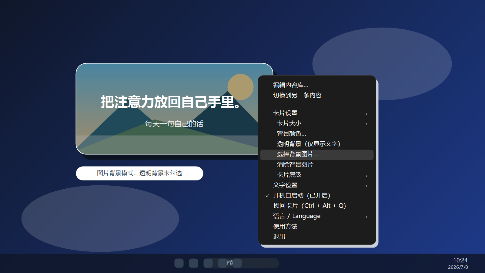
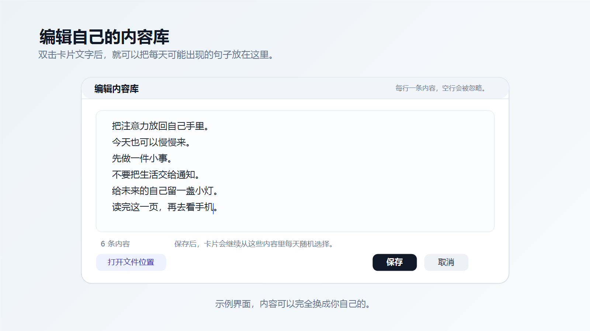
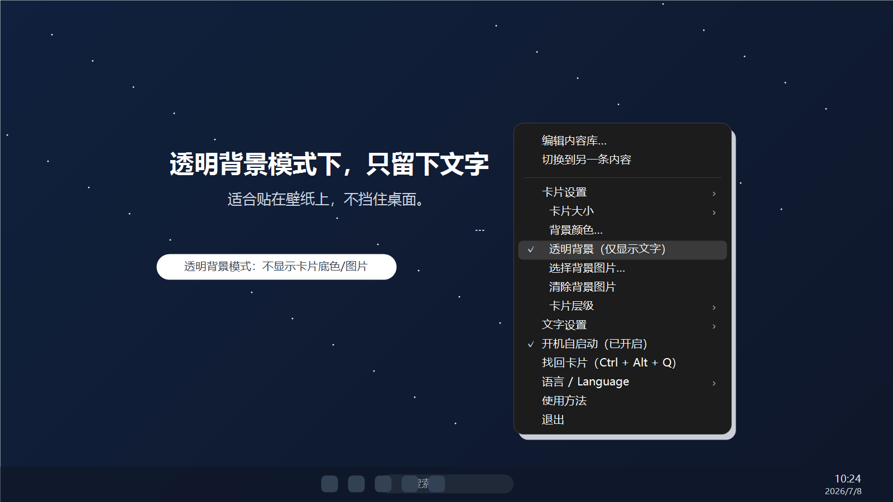
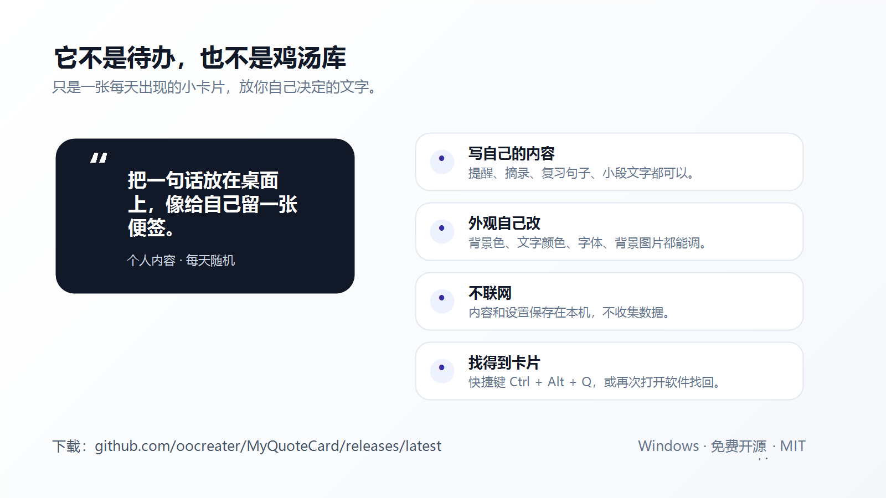

# 小笺 · XiaoJian

> 把你自己的话，放在你自己的桌面上。



[前往 Releases 下载最新版](../../releases/latest)

小笺是一张轻量的 Windows 桌面文字卡片。内容完全由你决定：写下句子、提醒、摘录或一小段话，软件每天随机显示一条。

默认外观是白底黑字，不显示日期或星期。你也可以自由调整颜色、字体、背景图片、透明背景、卡片大小和排版对齐方式。

## 截图

| 自定义背景和右键菜单 | 编辑内容库 |
| --- | --- |
|  |  |

| 透明背景 | 功能概览 |
| --- | --- |
|  |  |

## 主要功能

- 每天从你的内容库中随机选择一条内容
- 双击文字即可编辑这张卡片自己的内容库（每张卡片各有一份）
- 拖动卡片改变位置，拖动边缘或四角调整大小
- 尺寸完全自由：最小收到"文字区正好装下文字"（文字四周只留 12 像素内边距），最大铺满桌面；也可一步"适应文字大小（最小）"
- 卡片小到放不下右下角的"⋯"按钮时，按钮自动隐藏；右键卡片任意位置仍可打开全部菜单
- 文字自动适应卡片；“大一点 / 小一点 / 设为最小 / 恢复默认字号”也可由你指定字号（字号变大时卡片跟着长到装得下）
- “文字设置 → 排版对齐”可选左对齐 / 水平居中 / 右对齐，以及顶部对齐 / 垂直居中 / 底部对齐；横排与竖排都适用
- 自定义背景颜色、文字颜色、字体和背景图片
- 可选透明背景、置顶或置底
- 可选鼠标穿透：卡片显示在最上层，鼠标点击直达下层窗口
- 中文 / English 界面切换
- 可选随 Windows 开机启动（在系统的“启动”文件夹里放一个启动方式，不写注册表）
- 找不到卡片时，按 `Ctrl + Alt + Q`、双击托盘图标或再次打开软件
- 免安装、便携：数据就在程序旁边，把文件夹整个拷走就带走了全部内容；不联网、不收集数据

## 快速开始

1. 在 [Releases](../../releases/latest) 下载 `XiaoJian-0.9.12.exe`。
2. 把文件放到一个固定位置，例如自己建立的软件文件夹，或者 U 盘；首次运行会在旁边生成 `data` 文件夹。
3. 双击运行。第一次启动时可以选择是否开机自启动。
4. 双击卡片文字编辑内容；右键卡片打开全部设置。

软件目前没有代码签名。Windows 可能显示安全提醒，请确认文件来自本仓库并核对 Release 中提供的 SHA-256 校验值。

## 内容和设置保存在哪里

程序是便携式的：所有内容与设置都保存在程序旁边的 `data` 文件夹里。

```text
<程序所在目录>\data\
    state.ini            设置
    content-1.txt        第 1 张卡片的内容库
    content-2.txt        第 2 张卡片的内容库
    background-1.png     第 1 张卡片的背景图片
```

把程序和数据文件夹一起拷到别处（U 盘、另一台电脑），内容会跟着走。卸载时直接删除程序与 `data` 文件夹即可，不留其他痕迹，也不会往注册表里写东西。

如果程序放在不可写的位置（只读盘，或需要管理员权限的目录），会自动改用：

```text
%LOCALAPPDATA%\MyQuoteCard
```

这个目录名仍然是旧版本的名字，是特意保留的：这样就地升级也能读到原来的内容。第一次以便携方式运行时，旧版本存在上面那个目录里的内容会被自动带到 `data` 文件夹，只带一次，且不会覆盖 `data` 里已有的内容。也可以用 `XiaoJian.exe --data-dir=<目录>` 显式指定数据目录。

## 从源码构建

项目使用 Windows 自带的 .NET Framework 编译器，不依赖第三方程序包。

```text
双击 build.bat
```

构建完成后，程序位于 `dist\XiaoJian.exe`。也可以运行：

```text
XiaoJian.exe --self-test
```

进程返回值为 `0` 表示内置检查通过。

在 macOS / Linux 上也可以交叉编译出同一个 exe：

```text
dotnet build build-macos.csproj -c Release
```

## 怎么验证

这个程序是 WinForms，开发机上跑不起来，所以「功能是好的」只能靠断言。仓库里的 `tools/`
是完整的验证套件：源码级静态断言、反向注入（把代码故意改坏，断言必须报出来）、在 .NET 8 上
真跑抽取出来的纯逻辑、排版仿真、图标与 PE 结构。

```text
sh tools/verify_all.sh
```

细节见 [tools/README.md](tools/README.md)。每一项改动的设计取舍记在 [docs/notes/](docs/notes/)。

## 反馈

欢迎在 [Issues](../../issues) 报告问题或提出建议。请勿在截图或日志中公开自己的私人内容库。

本项目采用 [MIT License](LICENSE)。

---

## English

XiaoJian is a lightweight Windows desktop card for words chosen entirely by you. Add quotes, reminders, excerpts, or short passages; the app displays one random entry each day.

The default appearance is black text on a white card, with no date or weekday. Colors, fonts, background images, transparency, size, and window layer are customizable.

### Highlights

- A stable random entry for each day
- Double-click the text to edit this card's own library (every card has its own)
- Drag to move; drag an edge or corner to resize
- Any size at all: the floor is the text area holding the whole text, the ceiling is the desktop
- Automatic text fitting, or pick the size yourself with Larger / Smaller (the card grows to hold it)
- Text alignment: left / centre / right and top / middle / bottom, for horizontal and vertical text alike
- Custom colors, fonts, and background images
- Optional transparency, top or bottom window layer
- Optional mouse pass-through: the card stays on top while clicks reach the window below
- Chinese / English interface
- Optional launch with Windows, done portably: a launcher in your Startup folder, nothing written to the registry
- Press `Ctrl + Alt + Q`, double-click the tray icon, or launch the app again to find a lost card
- No installation: everything sits in a `data` folder beside the program, so copying that folder takes it all along. No network access, no telemetry

Download the latest EXE from [Releases](../../releases/latest). See [PRIVACY.md](PRIVACY.md) for the privacy statement.

### Where your content is kept

Everything lives in a `data` folder beside the executable: `state.ini` for the settings, `content-<n>.txt` for each card's library, and `background-<n>.<ext>` for each card's image. Copy the program and that folder together and your content comes with them; delete both to uninstall. Nothing is written to the registry. If the program sits somewhere it cannot write to, it falls back to `%LOCALAPPDATA%\MyQuoteCard`, and content from an older version is carried over to `data` the first time it runs portably. `XiaoJian.exe --data-dir=<folder>` picks a folder explicitly.
